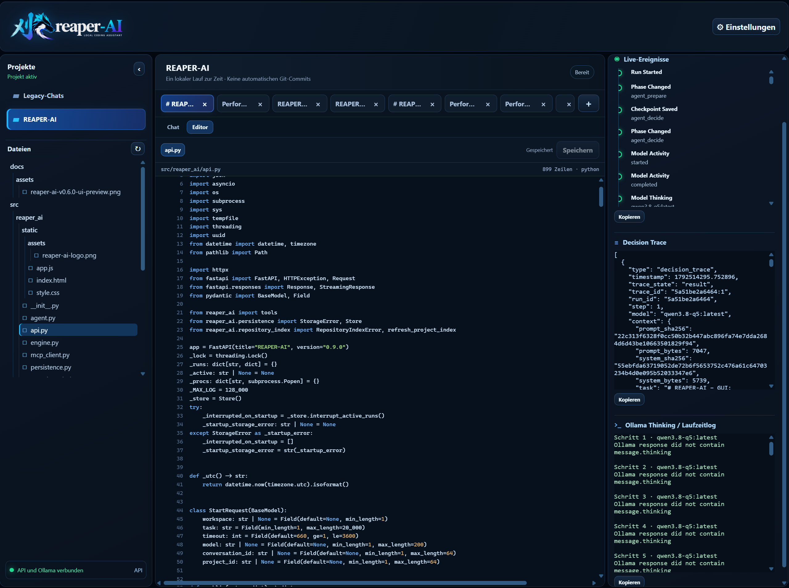

# REAPER-AI

<p align="center">
  
</p>

**Local, single-user AI coding agent.** REAPER-AI turns engineering requests into observable work: it iteratively inspects files, makes changes, runs checks, and reports the evidence actually produced. A model assertion is never treated as proof of success.

> **Version 0.9.1:** M5/P01–P03 local history, explicit recovery, scoped durable memory, the Variante-B multi-project core, repository index, hybrid per-run working memory, index-guided Sentinel navigation, and completed M6/P01–P06 iterative tool-agent work are implemented. P0 adds hash-bound targeted edits; P1 consolidates run working memory. D01 autonomous-agent acceptance is recorded as passed. v0.8.0 adds optional native MCP tool discovery and execution through the official Python SDK; v0.9.0 adds project file navigation and a guarded browser code editor; v0.9.1 adds S02/S03 evidence-aware working-memory handling for model assessments, open questions, and source-range prioritization.

v0.9.1 retains the v0.6.0 interface modernization and the D01 completion work: checkpointed source facts from every successful read, context prioritization for current targeted ranges, explicit reconciliation of satisfied read-only verification points, and visible no-information-gain evidence for identical reads. S02/S03 keep observed tool evidence separate from model proposals: an evidence-linked assessment can be supported, refuted, or inconclusive, while a successful read alone never closes a semantic question. Still-open questions and their evidence needs are prioritized with relevant source excerpts and remain explicit at finalization. The browser retains the same HTML/CSS/vanilla-JavaScript stack: projects and chats can be permanently deleted with their owned run history while project/global memory remains scoped correctly, and chat results now use the full available content width. The activity panel displays only recorded run events, decision traces, and available Ollama/log data; it does not invent progress or thinking. Live events, Decision Trace, and Ollama Thinking / runtime log can remain open together in independent, bounded scroll areas so long diagnostic data does not cover adjacent panels.

## Requirements and installation

Windows 11, Python 3.12+, and Ollama with at least one installed model are required. Git is optional.

```powershell
git clone https://github.com/robertbackhaus-a11y/REAPER-AI.git
cd REAPER-AI
py -3.12 -m venv .venv
.\.venv\Scripts\python.exe -m pip install .
ollama pull qwen3.6:35b
.\.venv\Scripts\python.exe -m uvicorn reaper_ai.api:app --host 127.0.0.1 --port 8000
```

Open <http://127.0.0.1:8000/>. For development, install with `pip install -e .` instead.

## Ollama configuration

REAPER-AI uses the local Ollama API at `http://127.0.0.1:11434`. Start Ollama before opening the application and install a model with `ollama pull <model>`. The browser lists installed models and starts each run with the selected model. Direct engine runs use `REAPER_MODEL` when set, otherwise the built-in default `qwen3.6:35b`. Sentinel requests JSON decisions with `think: false`, `format: "json"`, `stream: false`, `temperature: 0.0`, `top_p: 0.9`, `top_k: 40`, and `num_ctx: 16384`; the tested Qwen setup returned more reliable structured decisions that way.

Choose any existing absolute project directory, an installed Ollama model, and a bounded timeout in the browser. Git is an optional inspection tool, not a run precondition. The workspace supplies initial project context; tool paths may also be absolute and are subject to the started user's operating-system permissions. REAPER-AI never elevates permissions. It does not automatically commit, push, tag, publish, or release.

### Model choice

The current D01 comparison retains `qwen3.8-q5:latest` as Sentinel's primary model: it produced the strongest autonomous result among the three tested local models, although its factual-analysis quality still needs improvement. `qwen3.6:35b` was faster but too shallow, while Devstral Small 2 timed out in an unproductive index loop. The measured configurations, run evidence, limitations, and full evaluation are documented in [MODELCHOICE.md](MODELCHOICE.md).

## Iterative agent and tools (M6)

`src/reaper_ai/agent.py` provides the serializable state and central dispatcher for Sentinel's single iterative LangGraph path. Its checkpointed state includes a compact factual progress snapshot: most recent changed paths, recent tool checks with outcomes, open verification points, and recent tool/model errors. It uses file/Git adapters in `tools.py` and system adapters in `system_tools.py`; it does not introduce another tool implementation, service, or database.

Dispatchable actions are file listing/searching, UTF-8 file and line-range reads, text search, guarded whole-file writes, exact guarded text replacements, Git status/diff, Python-installation discovery, and shell commands. `apply_patch(path, expected_text, replacement, expected_hash)` changes one uniquely occurring source fragment without transferring or rewriting the rest of the file. Every result has `ok`, exit code where applicable, stdout/stderr or structured data, duration, change evidence, and a precise error. Full tool results remain persisted, while the planner receives bounded observation excerpts. Ordinary project scans omit Git object storage but `.git` remains explicitly addressable.

### MCP tools

REAPER-AI can also discover tools from configured Model Context Protocol (MCP) servers through the official Python MCP SDK. Put an optional `mcp.json` beside the application database (normally `%LOCALAPPDATA%\REAPER-AI\mcp.json`), or set `REAPER_MCP_CONFIG` to a different JSON file. A run discovers configured servers once during preparation; unavailable MCP servers are reported in its decision context but do not block local tools. Discovered tools are qualified as `mcp:<server>:<tool>`, with their description and input schema available to Sentinel. Each selected MCP action reconnects through the SDK, calls the tool, and becomes an ordinary observed result with no automatic semantic verification.

```json
{
  "mcpServers": {
    "example-local": {
      "command": "uvx",
      "args": ["example-mcp-server"]
    },
    "example-http": {
      "url": "http://127.0.0.1:8001/mcp"
    }
  }
}
```

`command` starts a local stdio server; `url` selects Streamable HTTP. An optional positive `timeout` (seconds), `env`, and `cwd` may be supplied for a stdio server. No server is bundled or started by REAPER-AI automatically.

Commands and tools execute with the started user's ordinary operating-system permissions—there is no automatic elevation, shell allow-list, command blacklist, risk class, or approval workflow. Timeouts and supervisor cancellation remain active. Existing text files must be read first and supplied with their returned SHA-256 hash; a changed source causes a conflict instead of an overwrite. `apply_patch` also requires that its exact original text occurs once, otherwise it leaves the file unchanged.

The active graph is `Prepare → Decide → Execute → Observe → Decide … → Finalize`. Ollama returns a JSON action or final-report decision; action decisions state why work remains and may name open verification points. Its compact system contract directs the planner to use known evidence first, end analysis when it is sufficient to implement, make minimal changes for development work, verify proportionately, and change strategy after errors or ineffective actions. A write proves only that the write succeeded; an independent successful checking action must name the exact open point in `verification_for` to clear it. A final decision is `completed` only when its evidence satisfies the goal; it can instead report the terminal outcome `partial` with a concrete, observed blocker. A read-only final decision can explicitly reconcile a satisfied analysis proof with `open_verifications: []`; it does not clear unrelated proof points automatically. The engine prioritizes checkpointed factual progress ahead of historical observations, dispatches deterministically, and stores the normalized result as an observation. A failed tool call, malformed JSON, or invalid decision becomes the next decision's evidence rather than ending the run. Every decision also emits a persisted Decision Trace with the exact prompt hash/size, the presented facts, decisions, gaps, visible source ranges, selected action, accepted model assessments/question updates, and later tool outcome/information gain. An open model question that reaches a final response without an evidence-linked update remains explicitly `inconclusive` in the terminal result rather than being inferred from final prose. When Ollama supplies a separate `message.thinking` field, it is emitted separately as `model_thinking`; absent data is recorded as unavailable and is never invented. Completion requires at least one successful tool result; a final model statement remains an assessment, not independent verification. The former static coding graph has been removed; historical static checkpoints remain in SQLite for record retention but are rejected safely because they have no executable graph.

Successful file and line-range reads are retained once as hash- and position-bound sources in checkpointed progress. Captured reads state whether they are truncated, their original and captured lengths, and the actual retained line span; empty line ranges are returned as actionable errors. Every successful source excerpt also creates a compact observed tool fact for its actual path, hash, and captured range; Python declarations, signatures, and imports add detail when the excerpt is independently parseable. Historical observations retain read metadata, not a second source-text copy. The prompt derives persisted coverage from the retained sources and visible coverage from the excerpts actually sent to Ollama. This retains evidence without forbidding a later reread when the agent needs a different range or detects changed source.

## Local history

M5/P01 uses Python's built-in SQLite support; no server, ORM, or background service is required. By default, the database is stored at `%LOCALAPPDATA%\REAPER-AI\reaper-ai.sqlite3`. Set `REAPER_DATA_DIR` to choose another **directory**; `reaper-ai.sqlite3` is created within it. Application data stays outside both this source checkout and target workspaces. SQLite files are ignored by Git.

The database stores conversations, user and factual terminal-result messages, run metadata/statuses/results, and bounded structured engine events with corresponding stage-result entries. The browser's conversation selector restores saved conversations and terminal results after an API restart. `GET /conversations`, `GET /conversations/{id}`, and `GET /runs/{run_id}` expose the same records for local tools.

## Projects

One SQLite database can now hold multiple local projects. A project has a stable ID, name, absolute workspace, optional description and supplemental Sentinel instructions, plus an Ollama model snapshot (`temperature`, `top_p`, `top_k`, and `num_ctx`). Projects may intentionally share a workspace while keeping their conversations, runs, and durable knowledge separate. New project runs always use the project workspace and persist their model/prompt configuration with the run, including recovery.

`GET/POST /projects`, `GET/PATCH/DELETE /projects/{project_id}`, `GET /projects/{project_id}/conversations`, and `GET/POST /projects/{project_id}/memory` provide the local API. Deleting an inactive project removes its project-scoped conversations, messages, runs, events, checkpoints, durable memory, and repository index in one SQLite transaction; workspace files and legacy records without a project assignment are never touched. A project with an active run cannot be deleted. Existing workspace-bound history is migrated once to generated legacy projects where unambiguous; ambiguous conversations remain accessible as legacy history. The browser sidebar lists projects and marks the active selection; project editing, workspace/model options, project knowledge, and index controls are grouped under the top-right settings control. Project conversations are shown as closeable, non-destructive tabs above the chat, while legacy chats remain reachable through their own project selection. Closing a tab only hides it. `DELETE /conversations/{conversation_id}` permanently removes that chat's messages, runs, events, checkpoints, and chat-sourced memory; `DELETE /conversations` removes every saved chat while retaining project/global memory. The browser requests cancellation of a matching active run before either deletion.

Each project also has an on-demand SQLite repository index. It stores file metadata (relative path, hash, language, size, line count, modification time), Python AST symbols, imports, and optional Git branch/HEAD—not source copies. Scans skip typical metadata, dependency, cache, and generated directories; an unchanged hash avoids a repeat Python parse, while added, changed, or removed files update the project-local index. `POST/GET /projects/{project_id}/index`, `GET /projects/{project_id}/index/files`, `.../symbols`, `.../imports`, and `.../top-python-files` refresh and query it. The final endpoint returns at most five project-scoped Python files with indexed symbols, ordered by symbol count and then path. The run API refreshes a project's index before it starts and after its supervisor ends. Index status, refresh, and simple file/symbol searches are available in the settings control. Sentinel receives a compact repository map once per run and can query files, symbols, per-file symbols, imports, and index status before requesting targeted source ranges.

The sidebar also renders the selected project's indexed files as an expandable tree. Selecting a text file opens it in the separate editor view, which supports Python, JavaScript, JSON, HTML, CSS, Markdown, and plain text using a small built-in highlighter rather than a frontend framework. Multiple opened files become editor tabs. `GET /projects/{project_id}/files/content` returns UTF-8 content and its SHA-256; `PUT` requires the displayed hash, so a changed file produces a conflict instead of an overwrite. Binary or undecodable files have no text preview, and a truncated large-file view cannot be saved.

Each run also carries a compact, checkpointed working memory: current phase/subtask, observed tool facts, model proposals, and explicit information gaps. Sources, actual changes, and verification state remain in their existing dedicated progress fields. One common observation path records tool evidence from reads, searches, repository-index queries, file changes, and checks; kinds remain distinct and model notes remain `proposed`. An open question names the exact evidence it needs. A model assessment or question update may cite observed path/hash/range evidence as supported, refuted, answered, or inconclusive, but it remains a model interpretation: a successful read proves only that its requested source was obtained and does not close a question automatically. Tool facts establish only their recorded outcome; a model hypothesis is not promoted automatically, and functional claims still require an appropriate observed check. The next decision receives its current task and still-open questions with their evidence needs before selected source excerpts, tool facts, model proposals, remaining gaps, verification, and a small metadata-only observation history. Open-question terms and already cited source ranges also inform excerpt selection, so generic historical gaps do not displace evidence for the current subtask. Successful evidence advances the recorded phase from orientation through targeted research, implementation, and verification, and a focused read does not demote an already concrete implementation task. The memory is restored on recovery, stays separate from project durable memory, and does not contain another complete source copy.

Raw supervisor logs remain temporary diagnostics and are not retained as a durable log archive. Stored events are capped at 32 KB each. A follow-up run in the selected conversation receives only a bounded set of prior user requests and recorded, observed run results; it never replays assistant/model prose and re-checks repository facts.

## Durable memory

P03 extends the same SQLite file with small, scoped durable-memory records that survive conversations and API restarts. New project records are scoped by stable project ID; legacy records retain their previous workspace scope. The implementation deliberately does **not** add Basic Memory, embeddings, or a vector database.

Only two kinds of knowledge are retained:

- An explicit **user-confirmed decision** submitted through the browser's **Projektwissen / Merken** action or `POST /memory`.
- One **observed result** for a completed run: a mechanical summary of its persisted verification level, changed files, and number of checks.

Assistant/model prose, ordinary chat messages, checkpoint state, and unsuccessful or unconfirmed completion claims are never automatically saved as verified knowledge. Memory is fetched only as a run begins, scoped to the selected project (or workspace for legacy runs), and is marked advisory: repository facts must still be checked. `GET/POST /memory` retain legacy compatibility; project routes provide isolated project knowledge.

## Checkpoint recovery

After each completed, nonterminal engine stage, REAPER-AI replaces a versioned SQLite checkpoint containing the full execution state and that stage's result. On API startup, stale `running`/`cancelling` runs are marked `interrupted`; nothing restarts by itself. The browser shows a recovery status and an explicit **Ab … fortsetzen** button for an interrupted, cancelled, or timed-out run with a valid checkpoint. The same operation is available via `GET /runs/{run_id}/recovery` and `POST /runs/{run_id}/resume`.

Recovery starts LangGraph at the checkpoint's next stage, so completed actions are not rerun. The agent saves the same SQLite checkpoint after `agent_prepare`, `agent_decide`, `agent_execute`, and `agent_observe`; a resumed agent starts at the stored safe stage with its plan, factual progress, observations, and pending action intact. A missing, corrupt, incompatible, workspace-inconsistent, or historical static-pipeline checkpoint is reported as unavailable or fails safely after the explicit request; it is never guessed or replayed automatically.

## API

The local API exposes:

- `GET /health`, `GET /models`, and `POST /projects/validate`
- `GET/POST/DELETE /conversations`, `GET /conversations/{conversation_id}`, and `DELETE /conversations/{conversation_id}`
- `GET /memory` and `POST /memory` for explicit durable user decisions
- `POST /runs` (optional `conversation_id`), `GET /runs/{run_id}`, `GET /runs/{run_id}/log`, `GET /runs/{run_id}/events`, `GET /runs/{run_id}/diff`, `POST /runs/{run_id}/cancel`, `GET /runs/{run_id}/recovery`, and `POST /runs/{run_id}/resume`

Starting a run without `conversation_id` creates a new conversation; supplying one appends the user request and resulting factual terminal summary to it. Persistence failures return a clear `503` at request time. If saving history fails only after a child run finishes, the observed engine outcome is still returned and the live response contains `storage_error`; the engine itself is not coupled to SQLite.

## Verification

Run the focused persistence checks with:

```powershell
.\.venv\Scripts\python.exe -m unittest discover -s tests -v
```

These tests cover history, durable-memory scope/source/restart behavior, checkpoint persistence/integrity, stale-run detection, explicit recovery availability, targeted large-file and conflict handling, and iterative agent behavior (read/search/range/write, external absolute paths, tool-failure correction, checkpointed decision recovery, Git, Python discovery, and shell output/error/timeout).

## Known limitations

- A completed run records observed tool evidence; it does not establish semantic or functional correctness unless the agent ran a suitable check.
- Recovery is explicit. REAPER-AI never restarts an interrupted run automatically, and it rejects missing, invalid, incompatible, or legacy static-pipeline checkpoints.
- Tool execution uses the started user's permissions. There is no automatic privilege elevation, commit, push, tag, release, or deployment.
- The v0.5.0 end-to-end acceptance run `f852b6ce174e` autonomously changed two source files with `apply_patch`, recovered from a cancelled checkpoint, corrected a failed verification script, and verified `GET /projects/{project_id}/index/top-python-files` through FastAPI `TestClient` against real index data. This is one successful coding workflow, not a claim that every coding task is reliably solved.
- The current workspace Git diff is an inspection result, not an immutable per-run diff snapshot.
- A terminal SSE replay can have a small status/event ordering inconsistency after a run ends. Persisted run status and result remain authoritative; this is non-blocking for v0.9.1.
- Model-supplied assessments and question updates remain optional decision fields. Qwen3.8 can complete a correct analysis without emitting them, and successful shell verification can still be repeated when compact observations omit its useful output. See [MODELCHOICE.md](MODELCHOICE.md) for measured model behavior.

## Development, test, and acceptance history

D01 autonomous-agent acceptance was accepted on 2026-10-20 with an overall grade of 3 (technical execution: 2; factual result quality: 4). The fresh read-only run `d01-1792496155` completed without source changes, recovered from invalid range requests, and did not repeat a successful range read. Its line-cited report was externally reviewed; one timeout claim was false and is recorded as a limitation rather than evidence of a new defect. The detailed, evidence-scoped history of earlier read loops, source-fact/context corrections, checkpointed verification reconciliation, focused tests, and remaining limitations is maintained in [ROADMAP.md](ROADMAP.md#reaper-ai--development-test-and-acceptance-history).

## Project documents

- [ARCHITECTURE.md](ARCHITECTURE.md) — architecture and persistence boundaries.
- [ROADMAP.md](ROADMAP.md) — milestones and acceptance criteria.
- [CONTRIBUTING.md](CONTRIBUTING.md) — contribution guidelines.
- [SECURITY.md](SECURITY.md) — local-execution considerations.

## License

[MIT](LICENSE).
